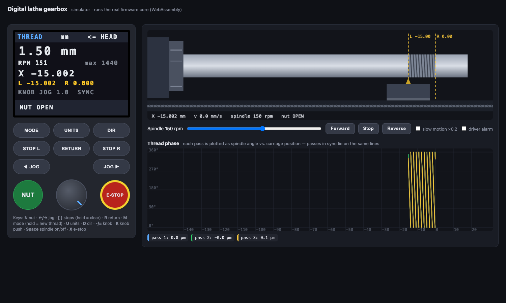

# digital-lathe-gearbox

An electronic leadscrew (ELS) with an electronic half-nut ("NUT button") for a
9x20 / 10x22-class lathe. A closed-loop NEMA23 drives the leadscrew and is slaved
to an encoder on the spindle, so the change gears are no longer needed. You get
any metric or imperial thread and feed, threading to a shoulder with stops, and
re-sync into the same groove on every pass.

Inspired by Not An Engineer's videos
([electronic gearbox](https://www.youtube.com/watch?v=iSDNKmk5B20),
[the nut button](https://www.youtube.com/watch?v=z1fYeBZptUc)).
All code and designs here are original.



## What's here

| Folder | Contents |
|---|---|
| [`docs/DESIGN.md`](docs/DESIGN.md) | System overview, key numbers, pin map, behaviour |
| [`docs/BOM.md`](docs/BOM.md) | Parts list with prices (≈ $385 minimum / $590 recommended) |
| [`docs/WIRING.md`](docs/WIRING.md), [`docs/wiring.svg`](docs/wiring.svg) | Every connection, interface board, E-stop, grounding |
| [`docs/INSTALL.md`](docs/INSTALL.md) | Fitting it to a 9x20, commissioning, calibration, first thread |
| [`firmware/`](firmware) | PlatformIO project for the Teensy 4.1 + unit tests of the motion core |
| [`cad/`](cad) | Parametric SolidCraft designs (built from `cad/params.json` by `cad/build.py`): base plate, pulleys, encoder bracket, door bezels, control box, and the lathe assembly with its fit checks |
| [`sim/`](sim) | Browser simulator running the **real firmware core** compiled to WebAssembly |

## Try it first: the simulator

Open `sim/web/index.html` in a browser (no server needed). The keypad, knob and
display are the real firmware UI. Spin the spindle up, set the stops, and cut a
few passes with **NUT** and **RETURN**. The phase plot shows each pass landing
in the same groove.

To rebuild after changing the core: `sim/build.sh` (needs `brew install llvm lld`).

## Firmware

```sh
cd firmware
pio test -e native                 # motion-core tests on your PC
pio run -e teensy41 -t upload      # build + flash the Teensy 4.1
```

Set your machine in `firmware/include/lathe_config.h`. That covers leadscrew TPI
or pitch, pulley teeth, encoder counts, limits and signal polarities. The pins
are in `firmware/include/pins.h`.

How it works, briefly:

* A 100 kHz interrupt reads the spindle count from the i.MX RT hardware
  quadrature decoder. It computes the exact carriage target
  `Z0 + floor((s − s0)·num/den)` in integer rational arithmetic, so there is no
  drift even for metric threads on an imperial leadscrew. A follower then emits
  steps toward that target, with feed-forward, accel/velocity limits and
  √(2a·d) braking onto stops.
* The **NUT** remembers the thread phase. A thread repeats every spindle
  revolution, so after a RETURN or any jog the nut *arms* and closes on the
  exact spindle angle that puts the tool back in the groove. In the tests and
  the simulator, repeated passes land within about 1.3 µm.
* Faults (E-stop, driver alarm, spindle too fast for the pitch) stop the
  carriage safely. The hardware E-stop also cuts the driver's 48 V through a
  relay, independently of the firmware.

## Controls

| Key | Action |
|---|---|
| **NUT** | Engage / open the half-nut. In thread mode a repeat pass arms and waits for sync |
| MODE | Feed ↔ thread · *hold*: start a new thread (forget the sync) |
| UNITS | mm ↔ inch |
| DIR | Toward headstock ↔ toward tailstock (left-hand threads) |
| STOP L / STOP R | Set the stop at the carriage · *hold*: clear |
| JOG ◀ / ▶ | Hold to jog |
| RETURN | Rapid back to the start of the pass |
| Knob | Turn: pitch/feed · push: knob jogs 0.01 / 0.1 / 1 mm |
| E-STOP | Cuts motor power. Release it, then press any key to clear |

**Threading to a shoulder:** set STOP L at the shoulder and STOP R at the start,
then press NUT for pass 1. The nut opens by itself at the shoulder. Retract the
cross slide, press RETURN, put on the next cut, and press NUT again. Repeat.

> ⚠️ This drives a machine tool. Verify the E-stop, the jog directions and the
> soft stops with the tool well clear of the work before your first cut, and
> follow the commissioning steps in `docs/INSTALL.md`.
